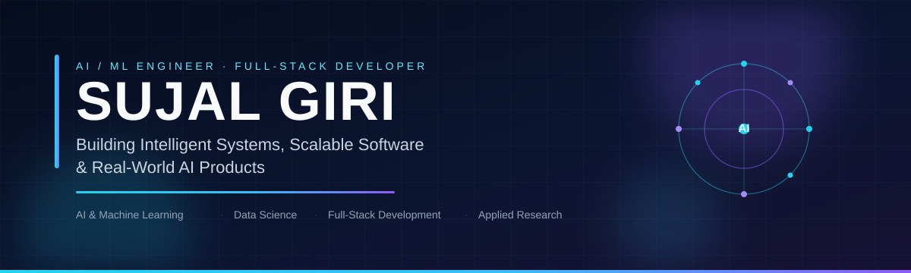

# Sujal Giri

**B.S. Computer Science & Data Analytics, IIT Patna · Aspiring AI/ML Engineer · Full-Stack Developer**

> Building Intelligent Systems, Scalable Software & Real-World AI Products

[Explore My Projects](#featured-projects) · [Connect With Me](#connect)

---

## In 15 seconds

| | |
|---|---|
| **Who I am** | Computer science student at IIT Patna (B.S., 2029) — building AI products and reproducing ML research with verified numbers. |
| **What I build** | Fraud-risk call analysis, QR-based safety systems, ML reproductions, and civic-tech prototypes. |
| **Strongest work** | LoRA reproduction (full fine-tuning 0.9106 → LoRA r=16 0.8968 on 1.32% of parameters) · CallSuraksha AI (live) |
| **Coding practice** | 317 questions solved across LeetCode, CodeChef and HackerRank · CodeChef 1506 (2★) · LeetCode 88 (17 Hard) |
| **Contact** | sujalgiri5@gmail.com · [LinkedIn](https://www.linkedin.com/in/sujal-giri-9501253a0) |

---

## About

I study computer science at IIT Patna while building practical AI software — systems that solve a real problem for a real user: a caller who might lose money to a scam, a venue that needs secure deposit handling, a city that needs to know which drain will flood first.

My work sits at the intersection of **AI, machine learning, data science, and scalable web apps**. I reproduce published methods and report the full result — including the seed-to-seed gap — and I do not claim a deployment, a result, or a role I cannot show.

Open to **AI/ML and data science internships, software engineering internships, and research collaboration** — including international and remote roles.

---

## Featured Projects

### [LoRA Reproduction](https://github.com/sujalgiriiitp-source/Lora---reproduction-) — DistilBERT + SST-2

Reproduced LoRA with rank ablation r=4/8/16 against full fine-tuning. Full fine-tuning: **0.9106** accuracy. LoRA r=16: **0.8968** on **1.32%** of parameters. All-linear r=16: **0.9071** — only 0.35pp below full fine-tuning. Seed gap reported honestly as **1.4–2.4pp**. 9 runs, fully reproducible.

*Python · PyTorch · Hugging Face · PEFT*

### [CallSuraksha AI](https://github.com/sujalgiriiitp-source/callsuraksha-ai) — "Call Suno, Risk Samjho." · [Live demo](https://callsuraksha-ai.onrender.com)

AI-assisted scam-risk analysis for **recorded** Hindi / Hinglish / English calls: transcription, explainable risk flags (Low / Medium / High / Unable to Assess), and spoken Hindi safety guidance. A risk flag — never a fraud verdict. No live-call interception, no deepfake detection, no caller identification.

*React 19 · TypeScript · Express · Gnani Prisma (speech-to-text) · Gnani Timbre (voice) · rule-based risk engine*

### [SafeTag](https://github.com/sujalgiriiitp-source/safetag-project) — QR-Based Secure Deposit System · [Landing page](https://safetag-project.vercel.app)

QR-based deposit handling with WhatsApp alerts for temples, exam centres, parks and museums — built with Team HackShield. Status, honestly: a **controlled-pilot candidate — production launch is not approved and no deployment is authorised yet**. The live link is the landing page, not a running product.

*TypeScript · Next.js · MongoDB*

### [NalaSetu](https://github.com/sujalgiriiitp-source/NalaSetu) — Predictive Municipal Drain Cleaning

A prototype that prioritises which drains to clean before heavy rain: risk score from rainfall forecast, blockage history, terrain and citizen reports, with a Leaflet map and crew-dispatch workflow. **Prototype with synthetic demo data — not operational municipal use.**

*React 19 · TypeScript · TanStack Start · AWS Lambda / DynamoDB (code)*

---

## More Projects

- **[CampusMate AI](https://github.com/sujalgiriiitp-source/campusmate-ai)** — AI study companion (topic explainer, study planner, practice questions) with Google Gemma. *Next.js · TypeScript · Tailwind*
- **[RideBuddy](https://github.com/sujalgiriiitp-source/RideBuddy0.1)** — Student ride-sharing platform with JWT auth. *React Native · Node.js · Express · MongoDB*
- **[FlowMind AI](https://github.com/sujalgiriiitp-source/FlowMInd---AI)** — AI workflow automation with Gemini, PostgreSQL and n8n (single-commit showcase; demo mode uses sample data). *TypeScript · Next.js*
- **[Customer Churn Prediction](https://github.com/sujalgiriiitp-source/customer-churn-prediction-pro)** — Churn prediction dashboard with ML and business insights. *Python · Streamlit · scikit-learn*
- **CodeVerse** — 3D computer-science learning game, in development (private repo, not linked). *Three.js · React Three Fiber*

---

## Coding Profile

Verified from [Codolio — SujalIITP](https://codolio.com/profile/SujalIITP) (11 Nov 2026): **317 questions solved** across platforms — LeetCode 88 (Easy 32 · Medium 39 · Hard 17, rating 1500, max 1720), CodeChef 176 (rating **1506, 2★** · DSA rating 1817), HackerRank 44 (all C++). 522 submissions · 77 active days · max streak 35 · 17 contests. Codeforces (9 solved) and GeeksforGeeks (0) are thin — the gap, left visible.

---

## Tech Stack

Only technologies demonstrated in actual projects. **Currently exploring:** Quantum Computing · LLM / RAG systems · Efficient fine-tuning.

---

## GitHub Stats

Public account, verified 11 Nov 2026: 51 public repositories, 0 stars, 3 followers. No stars claimed or hidden — the work above is the signal.

---

## Highlights

- **3rd Place (91 marks) — Innohack 3.0** for [QubitCraft](https://github.com/girishivansh/QubitCraft) — quantum computing learning platform, Team SRIJAN (Lead Developer). Its repository belongs to a teammate; linked as an achievement only.
- **SIH 2026 — Team SRIJAN**, Problem Statement SIH26140 (QubitCraft)
- **LoRA reproduction** — 9 runs, fully reproducible, results verified run-by-run

---

## Education

- **B.S. Computer Science & Data Analytics — IIT Patna** (2029) · CPI 9.18/10
- **B.Tech Computer Science & Engineering — SIET (AKTU)** (2028) · concurrent degree

---

## Connect

Open to research collaborations, hackathons, and internships — if you're building something in ML, quantum, or AI for Bharat, let's talk: **sujalgiri5@gmail.com**
